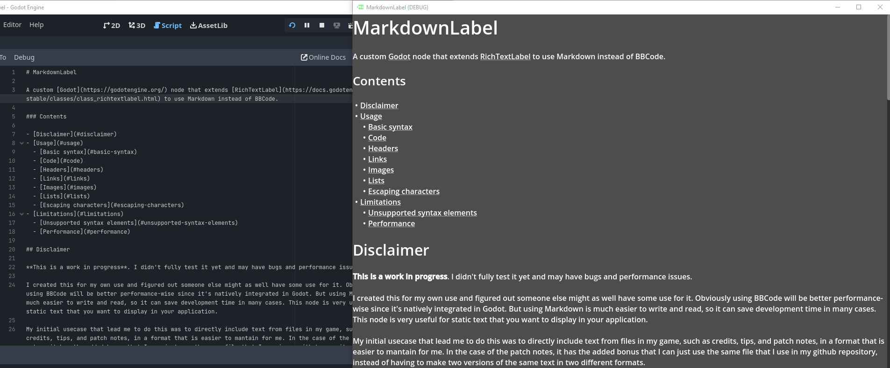

# MarkdownLabel

A custom [Godot](https://godotengine.org/) node that extends [RichTextLabel](https://docs.godotengine.org/en/stable/classes/class_richtextlabel.html) to use Markdown instead of BBCode.

Compatible with **Godot 4.2+**. A few syntax and styling features additionally require Godot 4.3, 4.5, or 4.6 — see [Godot version support](#godot-version-support). This fork is developed and tested with Godot 4.7 in the [gEmuera](https://github.com/wwwXiaoHan17/gEmuera) project.

> **gEmuera fork**
>
> This is a gEmuera-maintained fork of [Daenvil/MarkdownLabel](https://github.com/daenvil/MarkdownLabel) **1.4.0**. Version **2.0.0** keeps the original public API and the MIT license (see [LICENSE](LICENSE), copyright © 2023 Daenvil), and adds blockquotes, GFM tables, richer image handling, reference links, Setext headings, language-tagged fenced code blocks, new style properties, and a batch of bug fixes. See [CHANGELOG.md](CHANGELOG.md) and [Upgrading from 1.4.0](#upgrading-from-140).

### Contents

- [Disclaimer](#disclaimer)
- [Installation](#installation)
- [Usage](#usage)
  - [Basic syntax](#basic-syntax)
  - [Code](#code)
  - [Headers](#headers)
  - [Blockquotes](#blockquotes)
  - [Lists](#lists)
    - [Task list items (checkboxes)](#task-list-items-checkboxes)
  - [Tables](#tables)
  - [Links](#links)
  - [Images](#images)
  - [Horizontal rules](#horizontal-rules)
  - [Escaping characters](#escaping-characters)
  - [Internationalization](#internationalization)
  - [Advanced usage](#advanced-usage)
- [Style properties](#style-properties)
- [Godot version support](#godot-version-support)
- [Limitations](#limitations)
  - [Unsupported syntax elements](#unsupported-syntax-elements)
  - [Quirks](#quirks)
  - [Performance](#performance)
- [Upgrading from 1.4.0](#upgrading-from-140)
- [Acknowledgements](#acknowledgements)

## Disclaimer

I created this for my own use and figured out someone else might as well have some use for it. Obviously using BBCode will be better performance-wise since it's natively integrated in Godot. But using Markdown is much easier to write and read, so it can save development time in many cases.

The original 1.4.0 code was written quickly and without previous knowledge of how to parse Markdown properly. This 2.0.0 fork rewrites the block and inline parsers (and fixes several parsing bugs), but it is still not a full CommonMark implementation — see [Limitations](#limitations). Please report any unexpected behavior.

### Intended use case

This node is very useful for static text that you want to display in your application. It is not recommended for text that is dynamically modified at run time (the whole text is re-converted to BBCode whenever the node is marked dirty).

My initial use case that lead me to do this was to directly include text from files in my game, such as credits and patch notes, in a format that is easier to maintain for me. This has the added benefit of being able to use the same Markdown files that are displayed in a github repository, instead of having to make two versions of the same text in two different formats.

## Installation

**From source:**

1. Download the `addons` folder of this repository
2. Place it in your project's root folder (merge it if you already have an 'addons' folder)
3. Go to `Project > Project Settings... > Plugins` and enable the MarkdownLabel plugin

**From the AssetLib (upstream 1.4.0 only):**

1. Go to the AssetLib tab and search for MarkdownLabel
2. Click "Download" and then "Install"
3. Go to `Project > Project Settings... > Plugins` and enable the MarkdownLabel plugin

You might need to reload the project. The plugin version is stored in `plugin.cfg` (`2.0.0` for this fork).

## Usage

Simply add a MarkdownLabel to the scene and write its `markdown_text` field in Markdown format. Alternatively, you can use the `display_file()` method to automatically import the contents of a Markdown file.

In the RichTextLabel properties:

- Do not touch the `bbcode_enabled` property, since it's automatically set to `true` by MarkdownLabel to properly format its text. It's hidden from the editor to prevent misusage.
- Editing the `text` property has the same effect as editing `markdown_text`. It's hidden from the editor to prevent misusage.
- You can use the rest of its properties as normal.

You can still use BBCode tags that don't have a Markdown equivalent, such as `[color=green]green text[/color]`, allowing you to have the full functionality of RichTextLabel with the simplicity and readability of Markdown.

The node parses Markdown into BBCode only when it is marked as dirty (through `markdown_text`, `display_file()`, or `queue_update()`), instead of polling every frame. If a width-dependent image is present, it re-converts when the label is resized.


*An example of the node being used to display this Markdown file.*

### Basic syntax

Paragraphs and basic inline formatting work in the standard way. A blank line separates blocks. Note that **each source line is emitted as its own line** in the output (soft line breaks are not merged — this keeps explicit line breaks in documents such as the gEmuera manual), so long source lines should be left as single lines and are wrapped by RichTextLabel instead.

```
Markdown text ................ -> BBCode equivalent
-------------------------------||------------------
**Bold** or __bold__ ......... -> [b]Bold[/b] or [b]bold[/b]
*Italics* or _italics_ ....... -> [i]Italics[/i] or [i]italics[/i]
***Bold italics*** ........... -> [b][i]Bold italics[/i][/b]
~~Strike-through~~ ........... -> [s]Strike-through[/s]
```

Underscores inside a word (`snake_case_name`) are left alone; use asterisks if you need emphasis next to word characters.

### Code

You can display code in-line by surrounding text with one or more backtick characters, and you can display code in multiple lines (also called a fenced code block) by placing a line with three or more backticks or three or more tildes above and below your code block.

**New in 2.0.0:** the opening fence may carry an info string, typically a language label placed right after the opening fence characters (for example a `gdscript` label after three backticks). The label is accepted and ignored — Godot's BBCode has no syntax highlighting — so files written for GitHub render correctly. Fences may be indented by up to 3 spaces. The closing fence must use the same character, be at least as long as the opening fence, and contain nothing else. An unclosed fence runs to the end of the document.

**New in 2.0.0:** indented code blocks (4 spaces or 1 tab, outside lists and blockquotes) are also supported.

Examples:

A code block is emitted as one `[code]...[/code]` pair with literal newlines inside it (shown as `\n` here); the `[code]` and `[/code]` tags never sit on their own output lines.

````
Markdown text ................. -> BBCode equivalent
--------------------------------||------------------
The following is `in-line code` -> The following is [code]in-line code[/code]
This is also ``in-line code``   -> This is also [code]in-line code[/code]

```gdscript
line one
line two
```
                    -> [code]line one\nline two[/code]

    indented code   -> [code]indented code[/code]
````

**Important**: in-line code and code blocks **won't do anything with Godot's default font**, since it doesn't have a monospace variant. As described in [Godot's BBCode reference](https://docs.godotengine.org/en/stable/tutorials/ui/bbcode_in_richtextlabel.html#reference): *"The monospaced (`[code]`) tag only works if a custom font is set up in the RichTextLabel node's theme overrides. Otherwise, monospaced text will use the regular font"*.

### Headers

MarkdownLabel supports headers, although RichTextLabel doesn't. By default, a line defined as a header will have its font size scaled by a pre-defined amount. Each header level can be customized individually with its format resource (see [Header formats](#header-formats)).

**ATX headers** begin with 1 to 6 consecutive hash symbols (`#`); up to 3 leading spaces are allowed. For compatibility with 1.4.0 the space after the hashes is optional, so `#Title` is accepted as well as `# Title`. Lines with 7 or more hashes are treated as ordinary paragraphs. An optional run of trailing hashes is stripped (`## Title ##` becomes `Title`).

Example:
```
Markdown text:
## This is a second-level header

BBCode equivalent:
[font_size=27]This is a second-level header[/font_size]
```
where the `27` in `[font_size=27]` comes from multiplying the set `h2.font_size` (`1.714` by default) by the current `normal_font_size` (`16` by default).

**Setext headers** (new in 2.0.0) are a paragraph immediately followed by a line of one or more `=` (level 1) or `-` (level 2) characters, optionally indented by up to 3 spaces. A paragraph spanning several lines is joined with spaces and becomes a single header line:
```
This is a level-1 header
========================

This is a level-2 header
------------------------

One paragraph
on two lines
============
```
The last example becomes `[font_size=36]One paragraph on two lines[/font_size]`. A line of `---` with no paragraph line above it is still a horizontal rule, not a Setext header.

**Anchors.** Every header gets a GitHub-style anchor (lowercase; unicode letters, digits, underscores and hyphens kept; spaces become hyphens; other punctuation removed; duplicates get `-1`, `-2`, ... suffixes). Clicking a link to a valid anchor (such as the ones in [Contents](#contents)) scrolls the label to that header, as long as `automatic_links` is enabled. Anchors are recomputed on every update, so they no longer duplicate after the text is refreshed.

Headers may contain inline Markdown (e.g. `### Header with **bold** and *italic* words`).

The default relative font sizes are:

| Level | Default `font_size` multiplier | Resulting size with `normal_font_size = 16` |
| ----- | ----------------------------- | ------------------------------------------ |
| `h1`  | `2.285`                       | 36 px                                      |
| `h2`  | `1.714`                       | 27 px                                      |
| `h3`  | `1.428`                       | 22 px                                      |
| `h4`  | `1.142`                       | 18 px                                      |
| `h5`  | `1.0`                         | 16 px                                      |
| `h6`  | `0.857`                       | 13 px                                      |

When a header format's `draw_horizontal_rule` is enabled (Godot 4.5+), a horizontal rule is drawn below every header of that level, using the label's `hr_*` properties.

### Blockquotes

**New in 2.0.0.** A blockquote line begins with `>` (up to 3 leading spaces, optional one space after the `>`). Consecutive quote lines are merged into one quote block, together with *lazy continuation* lines: a directly following non-empty line that doesn't start a new block (fence, header, horizontal rule, list, table, or another quote) belongs to the same quote.

Nested quotes are written with repeated markers (`> > nested` or `>> nested`) and are rendered with one left bar per nesting level.

```
> A quoted paragraph.
> > A nested quote.
> - A list item
> ```
> code line
> ```
```

With default properties this renders as:
```
[indent][color=#8c8c8cff]│ [/color]A quoted paragraph.
[indent][color=#8c8c8cff]│ [/color][color=#8c8c8cff]│ [/color]A nested quote.[/indent]
[ul][color=#8c8c8cff]│ [/color]A list item[/ul]
[code]│ code line[/code][/indent]
```

Quotes support paragraphs, ATX/Setext headers, lists, fenced and indented code blocks, tables, inline formatting and links. The bar character, bar color, text color override, italics and background are all customizable — see [Blockquotes group](#blockquotes-group). Text lines — including list item text — carry one bar per nesting level. Lines inside quoted code blocks carry the bar as plain text (BBCode tags can't appear inside `[code]`), while table rows, horizontal rules and the `[ul]`/`[ol]` tags themselves are not prefixed with a bar; they are still indented by the quote level.

### Lists

Unordered list elements begin with a dash (`-`), asterisk (`*`), or plus sign (`+`) followed by a space. Ordered list elements begin with 1 to 9 digits followed by `.` or `)` and a space.

You can open nested lists by indenting new elements with any number of spaces or tabs. An item's continuation line (indented further than the marker column) is appended to the current item as a soft-wrapped line. A blank line ends the list, except that a following item with a matching indentation continues the same (loose) list.

**New in 2.0.0:** the first element of a top-level ordered list may start with any number (previously only a list starting at 1 was recognized), and `)` is accepted as a marker as well. Because Godot's `[ol]` tag has no start attribute, rendering always numbers from 1 — the source number is only used to recognize the list.

Examples:

Markdown text:
```
1. First element of an ordered list
2. Second element
  1. Nested element
1. Third element. The number at the beginning doesn't need to match the actual order.
  - You can also nest unordered lists inside ordered lists, and vice versa
	1. This is a nested list inside another nested list.
```
BBCode equivalent:
```
[ol]First element of an ordered list
Second element
[ol]Nested element[/ol]
Third element. The number at the beginning doesn't need to match the actual order.
[ul]You can also nest unordered lists inside ordered lists, and vice versa
[ol]This is a nested list inside another nested list.[/ol]
[/ul][/ol]
```

To write a literal ordered-list marker, escape the dot: `1\. Not a list`.

#### Task list items (checkboxes)

A task list item is an unordered list item which begins with `[ ]`, `[x]`, or `[X]` followed by a space. These characters are, by default, replaced with a checkbox icon when converting the text (☐ and ☑, respectively). These checkbox characters depend on the used font and may not display properly, so they can be customized using the `unchecked_item_character` and `checked_item_character` properties, where you can even insert an image using BBCode or Markdown syntax.

When clicking on a checkbox, it automatically checks/unchecks itself and emits the `task_checkbox_clicked` signal. This behavior can be disabled with the `enable_checkbox_clicks` property.

The arguments of the `task_checkbox_clicked` signal are:

- The id of the checkbox (used internally)
- The line number it is on (within the original Markdown text)
- A boolean representing whether the checkbox is now checked (true) or unchecked (false)
- A string containing the text after the checkbox (within the same line)

Task list items are recorded while parsing (including their source line), so clicking a checkbox after a re-conversion edits the correct line of the source Markdown. Example (run the `example.tscn` scene to test it):

- [ ] This is an unchecked item
  - [x] This is a nested task
- [x] This is a checked item
  1. This is a nested regular list
  2. Here goes another nested task list:
    - [ ] Task 1
    - [ ] Task 2

### Tables

Tables are constructed by separating columns with pipes (`|`). **New in 2.0.0:** [GFM delimiter rows](https://github.github.com/gfm/#delimiter-row) are supported and used for column alignment; the first row is rendered as a styled header row.

Example:
```
| Left aligned | Centered  | Right aligned |
| :----------- | :-------: | ------------: |
| cell 1       | **bold**  | inline code   |
| a \| b       | cell 4    | cell 5        |
```

- **Delimiter row:** written with at least one `-` per cell (GFM's usual three or more also work) plus optional `:` alignment markers. The delimiter row itself is not rendered.
- **Header row:** when a delimiter row is present, the first row is bold by default (`table_header_bold`) and its cells use `table_header_background` when that color is not transparent. Turn `table_header_row` off to render that first row as a normal data row; it then joins the zebra pattern like any other row.
- **Alignment:** a cell delimiter starting with `:` is left-aligned, ending with `:` is right-aligned, and both is centered. Inline formatting is allowed inside cells; block-level syntax is not.
- **Escaping:** a backslash-escaped pipe (`\|`) does not split a cell, and pipes inside inline code spans are ignored too.
- **Ragged rows:** rows with fewer cells are padded with empty cells, and extra cells are dropped. Empty header cells are allowed.
- **Cell styling:** borders, padding, header background and zebra-striped row backgrounds are applied automatically from the label properties — see [Tables group](#tables-group). Padding requires Godot 4.3+. Backgrounds are emitted per row as a single `bg=#RRGGBBAA` value: data row 1 uses `table_row_background`, row 2 uses `table_alternate_row_background`, and so on (header rows use `table_header_background` and are not counted in the zebra pattern).
- **Legacy tables:** a line with at least 2 unescaped pipes (and no delimiter row below it) still starts a table, as in 1.4.0. Such tables have no header styling; their columns use `table_default_alignment`.

The output uses one `[cell]` tag per column and a style attribute string with a fixed order (`border`, `padding`, `bg`):
```
[table=3]
[cell border=#8c8c8c66 padding=3,2,3,2][b]Left aligned[/b][/cell][cell ...][center][b]Centered[/b][/center][/cell][cell ...][right][b]Right aligned[/b][/right][/cell]
...
[/table]
```
A table ends at a blank line or at a line without an unescaped pipe; a following paragraph starts on a new line.

### Links

Links follow the standard Markdown syntax of `[text to display](https://example.com)`. Additionally, you can add tooltips to your links with `[text to display](https://example.com "Some tooltip")` (inline links accept double or single quotes around the title; reference definitions additionally accept `(title)`). The URL may be wrapped in angle brackets when it contains spaces: `[text](<path with spaces>)`.

**Reference-style links (new in 2.0.0)** use a link label pointing to a definition elsewhere in the document:

```
[the Godot docs][godot] and [also this][godot], or the shortcut form [godot].

[godot]: https://docs.godotengine.org "Godot documentation"
```

Definition rules: the label is case-insensitive, internal whitespace is collapsed to a single space, and the first definition wins if a label is defined twice. `[text][]` (empty label) and `[label]` (shortcut) forms are supported; a `[label]` without a matching definition is left as plain text (so raw BBCode like `[b]bold[/b]` keeps working). Definition lines are not displayed.

**Autolinks** are supported with their standard syntax: `<https://example.com>`, and `<mail@example.com>` for mail autolinks. Bare URLs (`https://...` and `www....`) are converted to links automatically too; this can be disabled with the `autolink_bare_urls` property.

Links created this way will be automatically handled by MarkdownLabel, implementing their expected behaviour:

- Valid header anchors (such as the ones in [Contents](#contents)) will make MarkdownLabel scroll to their header's position.
- Valid URLs and emails will be opened according to the user's settings (usually, using their default browser).
- Links that do not match any of the above conditions will be interpreted as a URL by prefixing them with "https://". E.g. `[link](example.com)` will link to "https://example.com". This can be disabled using the `assume_https_links` property (enabled by default), in which case the `unhandled_link_clicked` signal will be emitted.

This behavior can be disabled using the `automatic_links` property (enabled by default), in which case all links will be left unhandled and the `unhandled_link_clicked` signal will be emitted for all of them.

The `unhandled_link_clicked` signal can be used to implement custom behavior when clicking a link. It passes the clicked link metadata (which usually would be the URL) as an argument.

```
Markdown text ...................................... -> BBCode equivalent
-----------------------------------------------------||------------------
[this is a link](https://example.com) .............. -> [url=https://example.com]this is a link[/url]
[this is a link](https://example.com "Example page") -> [hint="Example page"][url=https://example.com]this is a link[/url][/hint]
<https://example.com> .............................. -> [url]https://example.com[/url]
<mail@example.com> ................................. -> [url=mailto:mail@example.com]mail@example.com[/url]
```

### Images

Images use the same syntax as links but preceded by an exclamation mark (!). The text inside the square brackets is the alt text; the optional title becomes a tooltip:

```
Markdown text ............................................... -> BBCode equivalent
--------------------------------------------------------------||------------------
 .................... -> [img alt="This is an image"]res://some/path.png[/img]
 -> [img alt="This is an image" tooltip="This is a tooltip"]res://some/path.png[/img]
 .................................... -> [img]res://some/path.png[/img]
```

The examples above assume the texture exists and is no wider than the label; otherwise the fit-width, alt-attribute and missing-image rules below apply.

Reference-style images are supported as well: `![alt][id]`, `![alt][]`, and `![alt]` (only when a definition for `alt` exists).

**Size and alignment extension (new in 2.0.0):** an image may be followed by a `{...}` attribute block (`image_allow_attributes`, enabled by default):

```
{width=100% height=2em align=center}
```

The supported keys are `width`, `height` and `align`, separated by spaces. `width`/`height` accept a plain number of pixels or a value with a `%`/`em` suffix (e.g. `width=50%`, `height=2em`); when either is given explicitly, automatic fit-to-width is skipped for that image. `align` accepts `inline`, `left`, `center` or `right` and overrides `image_alignment` for that image (only when it occupies a whole line).

Further image behavior (new in 2.0.0):

- **Fit to width:** with `image_fit_width` enabled (default), an image whose natural width exceeds the label width is rendered at `width=100%` (on Godot 4.2, as a pixel width). Images inside table cells are never auto-fitted, and an explicit `width`/`height` attribute disables auto-fit for that image.
- **Stand-alone alignment:** when a line contains nothing but a single image, `image_alignment` (`left`/`center`/`right`) wraps it in the corresponding alignment tag; an explicit `align` in the attribute block overrides `image_alignment` for that image. `inline` (the default) leaves it unwrapped. Images with a blockquote line prefix, and images inside table cells, are not wrapped.
- **Missing images:** if the texture can't be found and `image_show_alt_when_missing` is enabled (default), the alt text is displayed in italics instead of a broken-image placeholder (and a warning is pushed once per path for each converted line). If there is no alt text, nothing is displayed.
- **Alt attribute:** on Godot 4.6+ the alt text is also emitted as the `alt` attribute of the `[img]` tag.

Only local textures are supported: `res://` and `user://` paths use Godot's resource loader, anything else is checked as a filesystem path. RichTextLabel can't load images from network URLs.

### Horizontal rules

_**Note:** this feature is exclusive for **Godot 4.5+.** On older versions the source line is displayed as normal text._

Write a line with just three (or more) matching `-`, `_`, or `*` to form a horizontal rule (also called a thematic break).

You can customize the height, width, alignment, and color of all horizontal rules in the label by modifying its `hr_height`, `hr_width`, `hr_alignment`, and `hr_color` properties (by default they are 2 px high, 90% wide, center-aligned, and white). If you need to customize these properties individually for each rule, then you can just use the `[hr]` BBCode tag.

```
Markdown text  -> BBCode equivalent
---------------||------------------
---            -> [hr height=2 width=90% align=center color=#ffffffff]
 ____          -> [hr height=2 width=90% align=center color=#ffffffff]
***            -> [hr height=2 width=90% align=center color=#ffffffff]
```

Beware: a `---` line directly below a paragraph line is a Setext level-2 header. Leave a blank line above it if you want a horizontal rule.

### Escaping characters

You can escape characters using a backslash if you don't want them to form a Markdown syntax element. The backslash, backtick, asterisk, underscore, tilde, hash, plus, minus, dot, exclamation mark, pipe, brackets, parentheses, braces, angle brackets, double quote and single quote are all escapable. Escaped square brackets are displayed as literal brackets. You can escape backslashes if you don't want them to escape the following character. You can't escape characters inside in-line or fenced code, since the string will be displayed as-is. You also don't need to escape characters inside a link or image URL.

Examples:
```
Markdown text ............................ -> BBCode equivalent
-------------------------------------------||------------------
These \**outer asterisks*\* are escaped .. -> These *[i]outer asterisks[/i]* are escaped
1\. Not a list ........................... -> 1. Not a list
\> Not a quote ........................... -> > Not a quote
```

Note: to escape an ordered list, escape the dot that follows the number, e.g. `1\. Not a list`. To keep a literal `>` at the beginning of a line, write `\>`.

Keep in mind that, if you are writing text inside a script, you will have to "double escape" backslashes, since you are writing in a string. Some other characters, such as double-quotes, also need in-script escaping:

- In-script: `\\*`, `\\\"`
- In-editor: `\*`, `\"`
- Result: `*`, `"`

### Internationalization

By default, if `markdown_text` is set to a translation key, the label will automatically show the corresponding localized text. This is the same behavior as in other control nodes such as `Label` and `RichTextLabel`. This can be disabled by modifying the node's [`auto_translate_mode`](https://docs.godotengine.org/en/stable/classes/class_node.html#class-node-property-auto-translate-mode) property (Godot 4.3+) or the `auto_translate` property (Godot 4.2). Read [the official docs on game internationalization](https://docs.godotengine.org/en/stable/tutorials/i18n/internationalizing_games.html) for more information.

### Advanced usage

#### Front-matter

By default, the `display_file()` method separates YAML/TOML front-matter (if present) and actual Markdown content, only displaying the Markdown content. The front-matter is stored internally as a string and can be retrieved using the `get_frontmatter()` method afterwards. Pass `false` as the second argument of `display_file()` to display the document as-is.

#### Custom syntax

MarkdownLabel can be customized to handle custom syntax if desired. There are two methods which are meant to support this use case: `_preprocess_line()` and `_process_custom_syntax()`. These are called line by line (for every source line, including lines inside lists, tables and blockquotes) and do nothing by default. `_preprocess_line()` is called before any syntax in the line is processed by the node, while `_process_custom_syntax()` is called after the line has been converted to BBCode. These methods take a line as argument and return a processed line. This way, you can create a node that inherits from MarkdownLabel and override these methods in order to implement your custom syntax.

#### Raw BBCode

Any BBCode tag that doesn't collide with a Markdown construct is passed through untouched, so you can freely mix the two. Bear in mind that the node doesn't validate hand-written tags: an unclosed `[b]` in your source will affect everything after it, exactly like in RichTextLabel.

#### Internal architecture

Since 2.0.0 the node delegates to two internal `RefCounted` helper scripts: `markdown_parser.gd` (block-level parsing) and `markdown_inline.gd` (inline conversion). They are implementation details, not public API; subclass only the two hooks documented above.

## Style properties

Most properties can be edited in the inspector; every setter calls `queue_update()`, so changes are re-rendered on the next frame. Defaults shown here are the ones used by version 2.0.0.

### Existing properties

| Property | Type | Default | Description |
| -------- | ---- | ------- | ----------- |
| `markdown_text` | `String` | `""` | The Markdown source to display (hidden `text` is an alias). |
| `automatic_links` | `bool` | `true` | Handle link clicks (anchors, URLs, emails) automatically. |
| `assume_https_links` | `bool` | `true` | Open unknown links as `https://...` instead of emitting `unhandled_link_clicked`. |
| `h1` ... `h6` | `H1Format` ... `H6Format` | new resource each | Per-level header formatting (see [Header formats](#header-formats)). |
| `enable_checkbox_clicks` | `bool` | `true` | Make task list checkboxes clickable. |
| `unchecked_item_character` | `String` | `"☐"` | Character(s) shown for unchecked task items (accepts BBCode/Markdown). |
| `checked_item_character` | `String` | `"☑"` | Character(s) shown for checked task items (accepts BBCode/Markdown). |
| `hr_height` | `int` | `2` | Height of horizontal rules in pixels (0–99). Godot 4.5+. |
| `hr_width` | `float` | `90` | Width of horizontal rules, as a percentage of the label width (0–100). Godot 4.5+. |
| `hr_alignment` | `String` | `"center"` | `left`, `center` or `right`. Godot 4.5+. |
| `hr_color` | `Color` | `Color.WHITE` | Color of horizontal rules. Godot 4.5+. |

### Blockquotes group

Export group prefix: `@export_group("Blockquotes", "blockquote_")`.

| Property | Type | Default | Description |
| -------- | ---- | ------- | ----------- |
| `blockquote_bar_character` | `String` | `"│"` | Left bar character, repeated once per nesting level. |
| `blockquote_bar_color` | `Color` | `Color(0.55, 0.55, 0.55)` | Color of the left bar. |
| `blockquote_override_text_color` | `bool` | `false` | When enabled, quoted text uses `blockquote_text_color`. |
| `blockquote_text_color` | `Color` | `Color(0.75, 0.75, 0.75)` | Text color used when `blockquote_override_text_color` is enabled. |
| `blockquote_italic` | `bool` | `false` | Render quoted text in italics. |
| `blockquote_background_color` | `Color` | `Color(0, 0, 0, 0)` | Quote background; an alpha of 0 disables the background. |

### Tables group

Export group prefix: `@export_group("Tables", "table_")`.

| Property | Type | Default | Description |
| -------- | ---- | ------- | ----------- |
| `table_header_row` | `bool` | `true` | Render the first row of a GFM table as a header row. |
| `table_header_bold` | `bool` | `true` | Bold the header row cells. |
| `table_header_background` | `Color` | `Color(0, 0, 0, 0)` | Header row background; alpha 0 = no background. |
| `table_border_color` | `Color` | `Color(0.55, 0.55, 0.55, 0.4)` | Cell border color; alpha 0 = no borders. |
| `table_cell_padding` | `Vector4i` | `Vector4i(3, 2, 3, 2)` | Cell padding as (left, top, right, bottom); all zero = no padding. Godot 4.3+. |
| `table_row_background` | `Color` | `Color(0, 0, 0, 0)` | Background of odd data rows (row 1, 3, ...); alpha 0 = no background. |
| `table_alternate_row_background` | `Color` | `Color(0, 0, 0, 0)` | Background of even data rows (row 2, 4, ...); used with `table_row_background` for zebra striping. |
| `table_default_alignment` | `String` | `"left"` | Column alignment for tables without a delimiter row: `left`, `center` or `right`. |

### Images group

Export group prefix: `@export_group("Images", "image_")`.

| Property | Type | Default | Description |
| -------- | ---- | ------- | ----------- |
| `image_fit_width` | `bool` | `true` | Shrink images that are wider than the label to 100% width (Godot 4.3+; pixel width on 4.2). |
| `image_alignment` | `String` | `"inline"` | Alignment of images that occupy a whole line: `inline`, `left`, `center` or `right`. |
| `image_show_alt_when_missing` | `bool` | `true` | Show the alt text (in italics) when the image file can't be loaded. |
| `image_allow_attributes` | `bool` | `true` | Enable the `{width=... height=... align=...}` size/alignment extension. |

### Links group

Export group prefix: `@export_group("Links")`.

| Property | Type | Default | Description |
| -------- | ---- | ------- | ----------- |
| `autolink_bare_urls` | `bool` | `true` | Convert bare `https://...` and `www....` URLs into links. |

The original link-handling properties (`automatic_links`, `assume_https_links`) are listed under [Existing properties](#existing-properties).

### Header formats

Each of the `h1` ... `h6` properties holds a resource with the following fields:

| Property | Type | Default | Description |
| -------- | ---- | ------- | ----------- |
| `font_size` | `float` | level-dependent | Font size multiplier applied to `normal_font_size` (see the table in [Headers](#headers)). |
| `is_bold` | `bool` | `false` | Bold header text. |
| `is_italic` | `bool` | `false` | Italic header text. |
| `is_underlined` | `bool` | `false` | Underlined header text. |
| `override_font_color` | `bool` | `false` | Use `font_color` for this header level. |
| `font_color` | `Color` | `Color.WHITE` | Header text color, used when `override_font_color` is enabled. |
| `draw_horizontal_rule` | `bool` | `false` | Draw a rule below every header of this level (Godot 4.5+). |

### Signals and methods

| Member | Signature | Description |
| ------ | --------- | ----------- |
| `unhandled_link_clicked` | `signal(meta: Variant)` | Emitted for link clicks the node doesn't handle. |
| `task_checkbox_clicked` | `signal(id: int, line: int, checked: bool, task_string: String)` | Emitted after a task list checkbox is toggled. |
| `display_file()` | `func display_file(file_path: String, handle_frontmatter: bool = true) -> Error` | Load a Markdown file into `markdown_text`, optionally splitting front-matter. |
| `get_frontmatter()` | `func get_frontmatter() -> String` | Front-matter of the last file loaded with `display_file()`. |
| `queue_update()` | `func queue_update() -> void` | Mark the label dirty so the Markdown is re-converted on the next frame. |

## Godot version support

The addon declares Godot 4.2+ compatibility and gates newer features on the engine version:

| Feature | Minimum version | Behavior on older versions |
| ------- | --------------- | -------------------------- |
| Markdown parsing, lists, blockquotes, tables (no padding), links, reference links, code blocks | 4.2 | — |
| `table_cell_padding` / `[cell padding=...]` | 4.3 | Padding is omitted. |
| Image `width`/`height` with `%`/`em` suffixes and auto-fit at `100%` | 4.3 | Auto-fit is emitted as a pixel width; `%`/`em` size attributes are dropped (plain pixel values are kept). |
| `[hr]` horizontal rules and header `draw_horizontal_rule` | 4.5 | Horizontal rule source lines are rendered as plain text; no rule below headers. |
| Image `alt` attribute | 4.6 | `alt` is omitted (the missing-image fallback text is still shown). |
| `auto_translate_mode` property | 4.3 | Use the `auto_translate` property instead. |

This fork is developed and tested with **Godot 4.7-stable (mono)**. When in doubt, `Engine.get_version_info().hex` decides which output is generated.

## Limitations

Keep in mind that this is not supposed to be a full Markdown implementation, it just provides a Markdown interface to Godot's BBCode support and, as such, is limited by it.

If encountering any unreported bug or unexpected behaviour, please ensure that your Markdown is written as clean as possible, following best practices (this fork takes [CommonMark](https://commonmark.org/) and [GitHub-flavoured Markdown](https://github.github.com/gfm/) as reference, but it has its own peculiarities due to the use of Godot's BBCode).

### Unsupported syntax elements

The following Markdown syntax elements are **not supported**:

- Inline and block HTML
- Footnotes
- Definition lists
- Ordered lists whose rendered number should start at something other than 1 (Godot's `[ol]` has no start attribute; numbering always begins at 1)
- Soft line-break merging / paragraph reflow (each source line is emitted as its own line, by design)
- Full CommonMark emphasis nesting (the parser handles common cases like `***text***`, but arbitrary nested/overlapping emphasis may render differently)
- Images loaded from network URLs (RichTextLabel only loads local `Texture2D` resources)
- Block-level syntax inside table cells (only inline formatting, links and code spans are allowed there)

### Quirks

- A `---` line directly below a paragraph line becomes a Setext level-2 header, not a horizontal rule. Add a blank line above it if you want a rule.
- A line at the beginning of a paragraph that looks like a reference definition (`[label]: url`) is consumed as a definition and is not displayed.
- Only text lines inside a blockquote get a BBCode bar; quoted code lines get a plain-text bar, and structural lines (table rows, rules, the list tags themselves) are only indented.
- A code block is emitted as one `[code]...[/code]` pair with embedded newlines, so the `[code]` tags never occupy their own output lines.
- ATX headers accept a missing space after the hashes (`#Title`) for 1.4.0 compatibility, and 7 or more hashes are plain paragraph text.
- The `[code]` tag only looks monospaced when the label theme provides a monospace font.
- Hand-written BBCode is passed through without validation.

### Performance

This node parses the whole text, converting it from Markdown to BBCode when the text is marked dirty, so it may produce performance issues with some extreme usages, such as very large and heavily-formatted texts or updating a heavily-formatted text very frequently. That already can happen with BBCode, though, so in that case, you are probably better off [using RichTextLabel's functions](https://docs.godotengine.org/en/stable/tutorials/ui/bbcode_in_richtextlabel.html#using-push-tag-and-pop-functions-instead-of-bbcode) instead of writing the formatting directly in-text.

Compared to 1.4.0, regular expressions are compiled once and reused, string building avoids repeated quadratic concatenation, and the node only processes when it is dirty (no per-frame polling). Width-dependent images trigger a re-conversion when the label is resized.

## Upgrading from 1.4.0

The public API is unchanged, so scenes and scripts written for 1.4.0 keep working. Version 2.0.0 does change the rendering of a few constructs that used to be ignored or mishandled:

| Change | Effect | How to restore 1.4.0 behavior |
| ------ | ------ | ----------------------------- |
| Blockquotes are now parsed | Lines starting with `>` are rendered as indented quotes instead of literal text. | Escape leading markers: `\>`. |
| Reference links are now parsed | Lines of the form `[label]: url` are consumed as definitions and disappear from the output. | Escape the brackets or reword the line. |
| Setext headers are now parsed | A paragraph line followed by `===`/`---` becomes an H1/H2 header instead of plain text (`---` used to become a horizontal rule). | Add a blank line between the paragraph and the `---` line. |
| Bare URLs are autolinked | `https://...` and `www....` inside running text become clickable links. | Set `autolink_bare_urls = false`. |
| GFM delimiter rows affect rendering | The first row becomes a bold header (`table_header_bold`), and column alignment is honored. | Set `table_header_row = false` and `table_header_bold = false`. |
| Fenced code fences accept info strings | A fence with a language label (for example a `gdscript` label after the fence characters) is recognized as a code fence; before, the opening line was rendered as text. | — |
| Images fit the label width | Oversized images are scaled to 100% instead of overflowing. | Set `image_fit_width = false`. |
| Missing images show alt text | A missing texture renders its alt text in italics instead of a broken-image placeholder. | Set `image_show_alt_when_missing = false`. |
| Anchors reset on each update | Header anchors no longer accumulate duplicates after repeated re-conversions. | — (bug fix) |
| Anchor slugs use GitHub rules | Anchor fragments are now lowercase GitHub slugs (punctuation removed, `#` prefix kept), so hand-written `#Old_Punctuation!` links stop matching; regenerate them from the current header text. | Rewrite anchor links using the emitted slug (see the anchors section). |
| Checkbox clicks edit the right line | Task list clicks write back to the correct source line after text changes. | — (bug fix) |

New properties default to neutral values (transparent backgrounds, no text-color override), so no project migration is required; simply reviewing the rendering of existing content is enough.

## Acknowledgements

The syntax and implementation of MarkdownLabel is largely based on [Github-flavored Markdown](https://github.github.com/gfm/) and [CommonMark](https://commonmark.org/), with its own quirks to accomodate it within [Godot's RichTextLabel BBCode](https://docs.godotengine.org/en/stable/tutorials/ui/bbcode_in_richtextlabel.html).

Original MarkdownLabel by [Daenvil](https://github.com/daenvil), released under the MIT license. This fork keeps the original license (see [LICENSE](LICENSE)); the gEmuera-specific enhancements (2.0.0) are released under the same terms.
